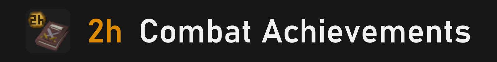
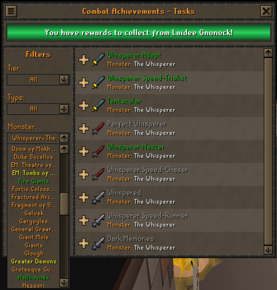
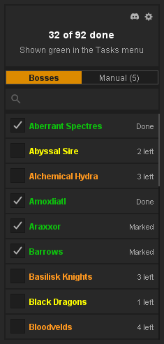
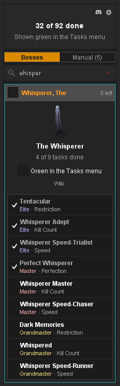

- A checklist of every Combat Achievements boss and monster, with its tasks and what's left. 
- Finished ones, and any you tick, show green in the game's Tasks menu.

<table width="100%">
<tr>
<td valign="top">

## What it shows

- **Every boss and monster.** All 92 names from the game's Monster list, each with a tick box and how many tasks are left.
- **Green in the game.** In Combat Achievements, Tasks, the Monster list shows finished names green and nearly finished ones yellow. Finished tiers turn green in the Tier list.
- **Each boss's tasks.** Click a boss for its picture, its progress and every task with its tier and type.

## Quick guide

1. **Open it.** Log in and click the book in the sidebar. Your progress is read straight away, with no menu to open first, and updates as you finish tasks.
2. **Tick a boss** to show it green, even with tasks left. Untick a finished one to keep it orange.
3. **Search.** Type part of a name, like "vork" or "theatre".
4. **Open a boss.** Click its name for its tasks and a link to its wiki page. Click a task to read it, with its own wiki link.
5. **Settings.** Click the settings icon to choose what turns green or yellow, pick your own colours, turn the wiki pictures off, or change the sidebar icon.

</td>
<td width="28"></td>
<td align="right" valign="top" width="235">

 

</td>
</tr>
</table>

 

<table width="100%">
<tr><td colspan="3"></td></tr>
<tr>
<td valign="top">

## Your marks

- **Your mark wins.** A boss you tick or untick stays that way, whatever your account says, until you click it back. A marked boss shows a **MANUAL** tag on its card.
- **Manual tab.** Every boss you've marked, with what the mark does, such as "Green instead of orange · 1 of 7 done". A dot on the tab shows when a new mark overrides your account.
- **Only your marks.** Turn off "Green when all tasks done" and only the bosses you tick turn green.
- **Your colours.** Pick the green, yellow, not-done and frame colours, and when a name turns yellow: 1 or 2 tasks left, started, half done or only Grandmaster left. The sidebar and the game's list change as you pick.

## Good to know

- **Nothing left out.** Shortened names like "DK: Prime" work too, and so do the Slayer and quest entries the game's Bosses page leaves out.
- **Per account.** Each account keeps its own marks.
- **Colours only.** Choose "Hide the sidebar button..." in the settings menu. Names then follow your account only, and your marks are kept. Turn it back on in RuneLite's settings.
- **Group Ironman and Deadman.** Tasks that don't count for your group size or world are left out, as the game does.
- **Privacy.** Nothing about your account is sent anywhere. With wiki pictures on, only a boss's name goes to the OSRS wiki, to fetch its picture.

</td>
<td width="28"></td>
<td align="right" valign="top" width="235">

 

</td>
</tr>
</table>

---

<strong>Found a bug or have an idea?</strong> Join the <a href="https://discord.gg/nsam4CfWzf">2hBuilds Discord</a>.

Every colour, mark and setting explained: <a href="https://github.com/2hBuilds/ca-boss-checklist/blob/main/DETAILS.md">full details</a>.
