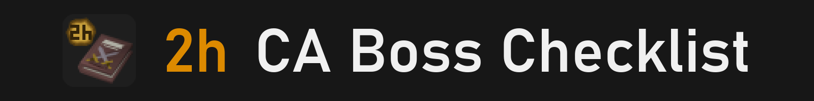
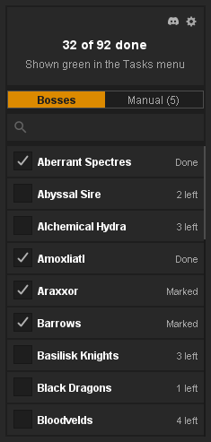
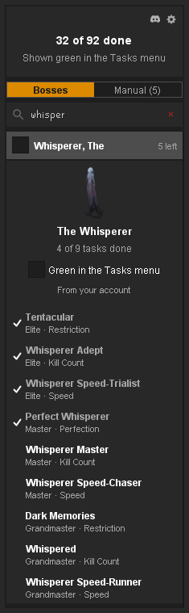

- A checklist of every Combat Achievements boss, with its tasks and what's left. 
- Finished bosses, and any you tick, show green in the game's Tasks menu.

<table width="100%">
<tr>
<td valign="top">

## What it shows

- **Every boss.** All 92 names from the game's Monster list, each with a tick box and how many tasks are left.
- **Green in the game.** In Combat Achievements, Tasks, the Monster list shows finished bosses green and bosses with one or two tasks left yellow. Finished tiers turn green in the Tier list.
- **Each boss's tasks.** Click a boss for its picture, its progress and every task with its tier and type.

## Quick guide

1. **Open it.** Log in and click the book in the sidebar. Your progress is read straight away, with no menu to open first.
2. **Tick a boss** to show it green, even with tasks left. Untick a finished one to keep it orange.
3. **Search.** Type part of a name, like "vork" or "theatre".
4. **Open a boss.** Click its name for its tasks. Click a task to read it, with a link to the wiki.
5. **Settings.** Click the settings icon to choose what turns green or yellow, turn the wiki pictures off, or change the sidebar icon.

</td>
<td width="28"></td>
<td align="right" valign="top" width="235">

 

</td>
</tr>
</table>

 

<table width="100%">
<tr><td colspan="3"></td></tr>
<tr>
<td valign="top">

## Your marks

- **Your mark wins.** A boss you tick or untick stays that way, whatever your account says, until you click it back.
- **Manual tab.** Every boss you've marked, in one list, to keep or remove.
- **Only your marks.** Turn off "Green when all tasks done" and only the bosses you tick turn green.

## Good to know

- **All 92 names.** Shortened ones like "DK: Prime" too, and the Slayer and quest entries the game's Bosses page leaves out.
- **Per account.** Each account keeps its own marks.
- **Group Ironman and Deadman.** Tasks that don't count for your group size or world are left out, as the game does.
- **Privacy.** Nothing about your account is sent anywhere. With wiki pictures on, only a boss's name goes to the OSRS wiki, to fetch its picture.
- **Something wrong?** Tell us in the 2hBuilds Discord - the link is in the settings menu.

</td>
<td width="28"></td>
<td align="right" valign="top" width="235">

 

</td>
</tr>
</table>

---

<strong>Found a bug or have an idea?</strong> Join the <a href="https://discord.gg/nsam4CfWzf">2hBuilds Discord</a>.

Every colour, mark and setting explained: <a href="https://github.com/2hBuilds/ca-boss-checklist/blob/main/DETAILS.md">full details</a>.
